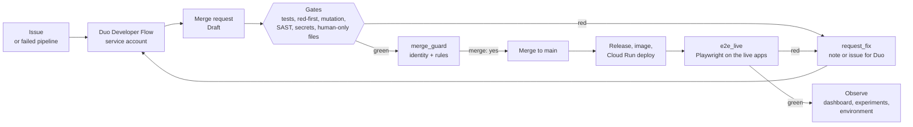
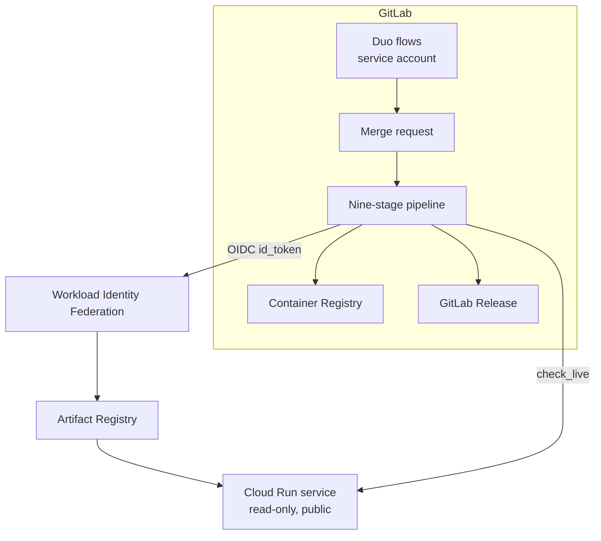
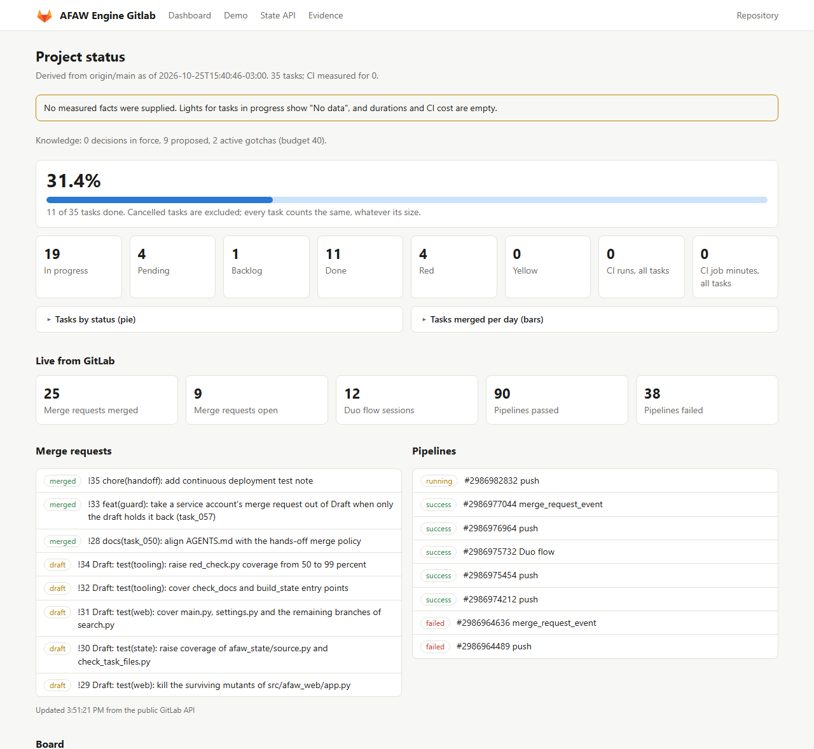
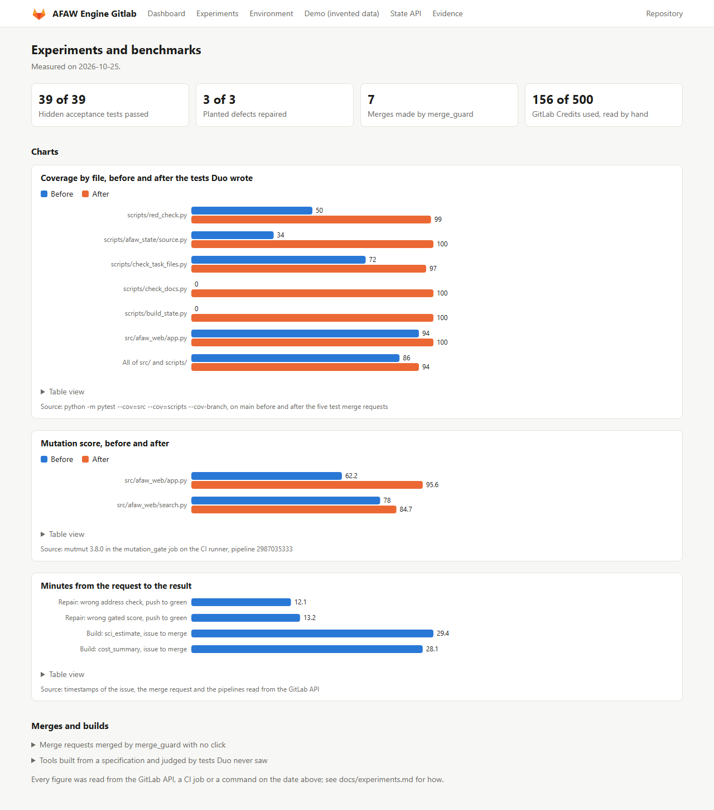
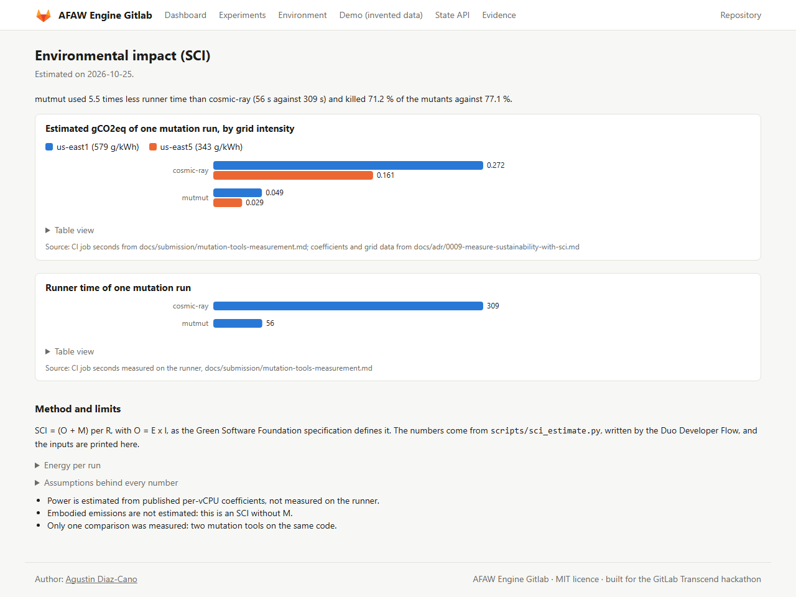
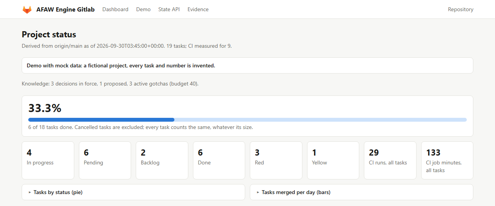
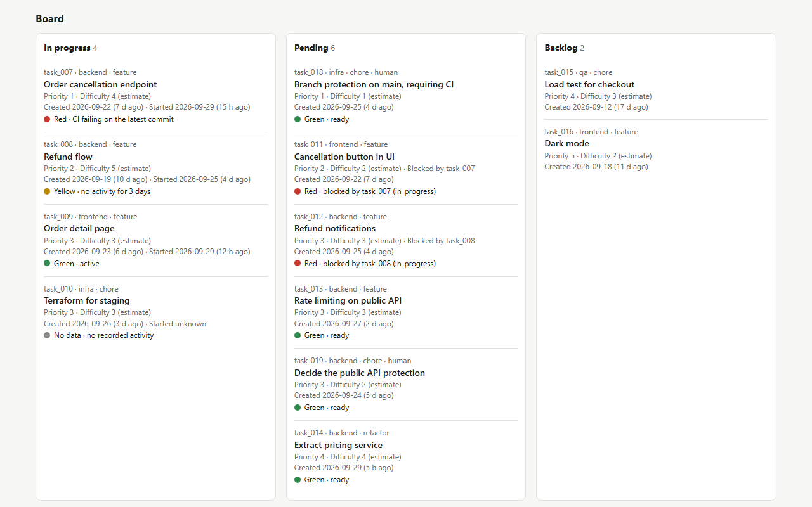
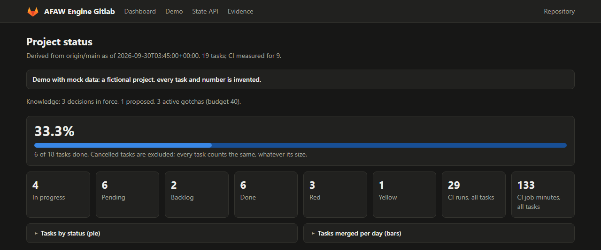

# AFAW Engine

**Deterministic governance for AI coding agents across the post-code DevSecOps lifecycle, built on GitLab and GitLab Duo Agent Platform.**

AFAW Engine is the entry of the AFAW (Anti-Fragile Agentic Workflow) method to the GitLab Transcend Hackathon "Life After Code" (Devpost). Agents write and repair code, deterministic tools decide whether a change is acceptable, and the human approves the merge policy instead of every merge.

**Built with:** Python 3.12 · FastAPI · GitLab CI/CD (9-stage pipeline) · GitLab Duo Agent Platform (Developer Flow, Fix CI/CD Flow, custom agent) · Terraform · Google Cloud Run · Workload Identity Federation · Docker · Playwright (end-to-end) · pytest · mypy `--strict` · ruff · mutmut (AST mutation testing) · Semgrep SAST · secret detection · Mermaid.

**What it does:** a failing check opens an issue, a Duo agent fixes it, a deterministic guard merges when every gate is green, Google Cloud Run redeploys, and a live browser test verifies the result. Around that loop: red-first TDD check, mutation testing, SAST, chaos experiments and a carbon (SCI) measurement of every flow.

**Measured so far:** 9 of 9 DevSecOps stages have a merge request written by a Duo agent. A planted bug was caught by a live test, fixed by Duo and redeployed in 23 min 44 s from issue to verified app, for 6.62 GitLab Credits ([details](docs/experiments.md#bug-benchmark-on-the-demo-app-from-a-failing-live-check-to-a-repaired-redeployed-app)). Limits are stated in [Why use it](#why-use-it).

- Author: **Agustin Diaz-Cano** ([www.agustindiazcano.com](https://www.agustindiazcano.com/))
- Hackathon: GitLab Transcend, "Life After Code" ([Devpost](https://gitlab-transcend.devpost.com/))
- Path: **B, Bring Your Own** (existing MIT project, imported to GitLab)
- Autonomy track: **Best Hands-off Agent**
- Also targeted: **Most Stages Covered**, **Google Cloud bonus** (Cloud Run)
- Optional, only if measured: **Most Environmentally Impactful** (see [Sustainability](#sustainability))
- Demo video: <DEMO_VIDEO_URL>
- Live service (Google Cloud Run): https://afaw-handsoff-ljm5hefnsq-uc.a.run.app
- Source of truth: https://gitlab.com/gitlab-ai-hackathon/transcend-october-2026/43344247/showcase (a mirror is kept at https://github.com/agustindiazcano/afaw-engine-gitlab)
- Original project (MIT, upstream): https://github.com/agustindiazcano/afaw-anti-fragile-agentic-workflow
- License: [MIT](LICENSE)
- White paper: [`docs/paper/afaw.pdf`](docs/paper/afaw.pdf), DOI [10.5281/zenodo.23050310](https://doi.org/10.5281/zenodo.23050310)

> Status legend used in this document: **Done** (merged, evidence given), **Merged, not deployed** (code in `main`, needs a human step), **In progress**, **Planned**. Nothing marked Planned or In progress is claimed to work.

---

## Index

| Section | What is there |
|---|---|
| [Problem](#problem) and [Why use it](#why-use-it) | What the project is for |
| [The loop](#what-this-variant-changes-hands-off) and [Hands-off status](#hands-off-status) | Each link of the loop and whether it ran |
| [Hackathon requirements](#hackathon-requirements-and-status) | Devpost requirements and their state |
| [The nine stages](#the-nine-stages) and [Stages and Duo](#stages-and-duo) | The jobs of each stage and where a Duo flow ran |
| [Demo app](#demo-app) and [End to end tests](docs/e2e.md) | The deployed app the agents change, and the browser tests that watch it |
| [Hands-off method](docs/method-handsoff.md) | Diagrams of the loop, self-repair, merge decision, control layers and observability |
| [Stack](#stack) | Technologies; Google Cloud, Terraform and CI/CD in [`docs/stack.md`](docs/stack.md) |
| [Dashboard](#dashboard) | Live, experiments and environment pages |
| [Guardrails](#guardrails-and-known-limits) and [Sustainability](#sustainability) | Limits and the carbon estimate |
| [Experiments](docs/experiments.md) and [evidence](docs/submission/evidence.md) | Measured results, link by link |
| [How to run it](#how-to-run-it) and [Getting started](#getting-started-gitlab) | Setup |


## Problem

Several coding agents on one repository fail in predictable ways: they collide on branches and shared context files, claim results they never measured, and write tests that pass whatever the code does. Once code generation is cheap, the open problem is everything after the code: review, security, tests, compliance, release and monitoring.

AFAW Engine runs that part with GitLab Duo flows, while deterministic tools (CI jobs, scripts, security scanners) decide what is acceptable. Principle: **the AI decides, the engine measures.** Every number comes from a deterministic tool, and a value an agent could have made up is rejected where it would be declared.

## What is AFAW, in plain words

Several AI assistants can now write code in the same project at the same time. Left alone, they
get in each other's way, they say a job is finished when it is not, and nobody can tell how the
project is doing without reading everything.

AFAW is a small set of rules and checking programs that fixes this:

- **One job, one branch.** Each assistant gets one task and works on its own copy, so two of them
  do not edit the same thing.
- **One shared notebook.** Every task, decision and result is written in the repository in the
  same format. The status board is built by a program from GitLab, not typed by anyone, so a
  person or an assistant can read how the project is going without guessing.
- **Nobody marks their own homework.** Ordinary programs check what the assistant says. A new test
  must fail on the old code. The list of files it says it changed must match the real change. A
  number it reports must come from a measurement, not from the assistant.

AFAW Engine, this repository, goes one step further for the hackathon: when every check is green a
program merges the change, with no person clicking; when something breaks, an issue is opened for a
GitLab Duo assistant to fix; the app is redeployed and a browser test checks the live site.

## Why use it

What each benefit rests on today. "Measured" means we read the number from GitLab on the day shown
and the link is in the [evidence](docs/submission/evidence.md) or the
[experiments](docs/experiments.md).

| Without AFAW | With AFAW | Do we know it works? |
|---|---|---|
| Assistants overwrite each other | One task, one branch; the pipeline rejects a task number that is already taken | **Partly.** On 2026-10-25 the task-file check failed on clashing task numbers and copied task files four times (issues #48, #49, #51, #52). It caught them; it did not prevent them, because two assistants picked the same number at the same moment |
| An assistant says "done" and it is not | Programs check the claim: red-first test, mutation check, files changed, live check of the deployed app | **Yes, measured.** Six defects planted on purpose were repaired and none was missed by the checks ([experiments](docs/experiments.md)); a browser test also caught a bug that every earlier test missed |
| Nobody can tell how the project is going | A board built from the GitLab API with a light for each task | **Yes, with a gap.** It exists and runs; the live dashboard still shows older numbers than the repository |
| A broken build waits for a person | Failing check, then an issue, then a Duo fix, then an automatic merge and deploy | **Yes, measured.** For the planted bug of 2026-10-26: issue opened at 01:00:37 UTC, fix merged at 01:13:29 UTC, 12 min 52 s |
| A new assistant must read everything | It starts from one index (`LASTCONTEXT.md`) and a hand-over file | **Not measured.** We expect it saves effort; we have not compared it with reading the code |
| Running more tests than needed wastes energy | The assistant runs only its own test; the pipeline runs the rest once | **Not measured as a saving.** We measure the cost of a change: see [Sustainability](#sustainability) |

What it does not prove: the undraft and the merge are done with a person's access token, so
GitLab shows that person's name. The Code Review Flow and the summary comment on the issue never
ran. A repair that needed more than one attempt has not happened yet.

## What this variant changes (Hands-off)

| | AFAW (upstream) | AFAW Engine (this repository) | Status |
|---|---|---|---|
| Merge | A human approves every pull request | The human approves the **policy**; the deterministic engine approves **each merge** ([ADR 0007](docs/adr/0007-engine-approves-each-merge-human-approves-the-policy.md)) | Policy documented; the automatic merge rule is merged (task 012, `merge_guard`) and has never run on a real merge request. Every merge so far was a person's |
| Measuring | The AI decides, the engine measures | Unchanged | Done |
| Forge | GitHub | GitLab (REST API v4); the GitHub path is kept | Done for facts: they are read from the GitLab API ([`docs/facts.md`](docs/facts.md), task 010) |
| Agents | Coding agents that open pull requests | GitLab Duo flows, configured to run under a group service account instead of a personal token ([`docs/duo.md`](docs/duo.md)) | Configuration merged; the Developer Flow ran four times and opened !16, !17 and !18; the Fix CI/CD Pipeline Flow ran once by hand ([evidence](docs/submission/evidence.md)) |
| Guardrails | Human reviews each diff | Human-only files (a weak control, see [limits](#guardrails-and-known-limits)) and a red-first check that a new test fails on the old code | Done |
| | | Cap of 3 automatic fix attempts per merge request, merge only when the full pipeline is green | Code and tests merged (task 012); never run on a real merge request |

Diagrams of the loop, the self-repair, the merge decision, the control layers and the observability: [`docs/method-handsoff.md`](docs/method-handsoff.md). The loop is the target design; the status of each link is in [Hands-off status](#hands-off-status):



Not in the diagram because it has not run: a review by the Code Review Flow and a summary comment on the issue.

## Hackathon requirements and status

| Requirement | Status | Evidence |
|---|---|---|
| Uses GitLab Duo Agent Platform (agents, flows, MCP clients) | Done for the Developer Flow, in progress for the rest | The Developer Flow, started by assigning an issue through the API, opened merge requests that `merge_guard` merged; the Fix CI/CD Pipeline Flow ran once, by hand, and only commented; the Code Review Flow never ran ([evidence](docs/submission/evidence.md)) |
| Public GitLab project with all source, assets and instructions | Done | https://gitlab.com/gitlab-ai-hackathon/transcend-october-2026/43344247/showcase (visibility public) |
| MIT License visible in the repository | Done | [`LICENSE`](LICENSE); the project API reports the license key `mit` |
| Visible CI/CD pipeline history showing the automation | Done | Pipelines of the project, including failed ones, and the repairs that followed them; the failures on `main` are explained in [limits](#guardrails-and-known-limits) |
| Text description | In progress | Derived from this README; see [`docs/submission/devpost.md`](docs/submission/devpost.md) and [`docs/submission/rules-and-coverage.md`](docs/submission/rules-and-coverage.md) |
| Demo video under 3 minutes, YouTube, no third-party trademarks or copyrighted music | Planned | <DEMO_VIDEO_URL> |
| Path B: what was added or changed since Oct 5, 2026 | Done | [Added since Oct 5](#added-on-or-after-oct-5-2026) |
| Path B: deployed project URL, kept live until about Nov 16 | Done | https://afaw-handsoff-ljm5hefnsq-uc.a.run.app (`/health` answered `ok` on Oct 24, 2026) |
| Path B: URL of the original MIT project | Done | Link at the top |
| Google Cloud bonus: deployment code in the repository and public URL | Done | `deploy/terraform` ([`cloud_run.tf`](deploy/terraform/cloud_run.tf)), [`docs/google-cloud.md`](docs/google-cloud.md) |
| Most Environmentally Impactful (opt-in, SCI) | Planned, conditional | [Sustainability](#sustainability) |

## The nine stages

`.gitlab-ci.yml` defines 29 jobs, plus the jobs of the SAST and secret-detection templates. `test` is a technical stage: the GitLab SAST and secret-detection templates require it to exist, and none of our jobs runs in it. The nine DevSecOps stages are the other nine.

| Stage | Jobs (script) | GitLab-native feature | Status | Tasks |
|---|---|---|---|---|
| plan | `task_files` (`check_task_files`), `docs_check` (`check_docs`), `duo_config` (`check_duo_config`) | Merge request pipelines (`workflow:rules`) | Done | 009, 011 |
| create | `task_delta` (`check_task_delta`), `derived_views` and `web_data` (`build_state`) | Merge requests opened by the Developer Flow, review rules in `.gitlab/duo/` | Done for the Developer Flow started by a person (!16 to !18); not started by a trigger or by a template yet | 009, 011 |
| verify | `lint` (`ruff`), `typecheck` (`mypy --strict`), `tests` (`pytest`), `red_check`, `mutation_gate` (`mutation_ci`) | `rules:changes` path filters, pipeline cache | Done | 009 |
| secure | `semgrep-sast`, `secret_detection`, `security_gate` (blocks on any secret or a Critical or High SAST finding) | SAST template (Semgrep) and pipeline secret detection | Done | 009 |
| govern | `paper_pdf`, `equivalent_mutants_report`, `human_only_files` (a **weak** backup control: the same merge request can edit it away) | Strong control deferred: pipeline execution policy or CODEOWNERS with required approval, depending on the tier | Done (weak); strong control Planned | 009, 012 |
| package | `package_docker` (service `Dockerfile`); `package_buildah` as the fallback, selected with `PACKAGE_BUILDER=buildah` | GitLab Container Registry | Done for `package_docker`; the Buildah path has not run | 009, 013 |
| configure | `check_configuration` (`check_ci_config`: config schema and CI variables, by name only), `terraform_validate` | Protected CI/CD variables | Done: `check_configuration` passes on `main` since the `GCP_*` variables were set by a human ([pipeline](https://gitlab.com/gitlab-ai-hackathon/transcend-october-2026/43344247/showcase/-/pipelines/2985631519)) | 009, 013 |
| release | `release` (`glab`), `publish_image` and `deploy_cloud_run` (`gcp_access_token.sh`, `gcloud run deploy`) | `release:` keyword (a GitLab Release per pipeline on `main`); `id_tokens` with Workload Identity Federation | Done: `release`, `publish_image` and `deploy_cloud_run` passed on `main` with Workload Identity Federation | 009, 013 |
| monitor | `monitor` (`collect_facts`, `build_state`), `monitor_live` (`check_live`: fails if live `/health` or `/api/state` does not answer) | Job artifacts | Done: `monitor` runs `collect_facts` on the GitLab API and `monitor_live` checks the live service; both passed on `main` | 009, 010, 013 |

Verified in docs.gitlab.com (Oct 24, 2026): the SAST and secret-detection templates run in the `test` stage and only in branch pipelines by default, so `.gitlab-ci.yml` moves them to `secure` and also runs them in merge request pipelines. Basic Semgrep SAST and the secret-detection JSON report are in every tier; findings in the merge request and Advanced SAST need Ultimate. Kaniko is marked as no longer maintained, so Buildah is the fallback.

## Stages and Duo

Counts are read from the evidence file on the day written; a Duo flow counts only if a session ran
and left a merge request, a commit, an issue or a note. Touching a stage is enough for the Most
Stages Covered prize ([rules](docs/submission/rules-and-coverage.md)).

| Stage | Job that runs | A Duo flow ran here | Evidence |
|---|---|---|---|
| plan | `task_files`, `docs_check`, `duo_config` | Duo-authored change to `check_task_files` (a count of files checked), merged by `merge_guard` | [#37](https://gitlab.com/gitlab-ai-hackathon/transcend-october-2026/43344247/showcase/-/work_items/37) → [!79](https://gitlab.com/gitlab-ai-hackathon/transcend-october-2026/43344247/showcase/-/merge_requests/79) |
| create | `task_delta`, `derived_views`, `web_data` | Yes: the Developer Flow opened merge requests from issues | [evidence](docs/submission/evidence.md) |
| verify | `lint`, `typecheck`, `tests`, `red_check`, `mutation_gate` | Yes: Fix CI/CD once; repairs from `request_fix` issues | [evidence](docs/submission/evidence.md), [experiments](docs/experiments.md) |
| secure | `semgrep-sast`, `secret_detection`, `security_gate` | Duo-authored change to `security_gate` (JSON summary), merged by `merge_guard` | [#38](https://gitlab.com/gitlab-ai-hackathon/transcend-october-2026/43344247/showcase/-/work_items/38) → [!77](https://gitlab.com/gitlab-ai-hackathon/transcend-october-2026/43344247/showcase/-/merge_requests/77) |
| package | `package_docker`, `package_demo_app` | Duo-authored change to the demo app image (`HEALTHCHECK`), merged by `merge_guard` | [#39](https://gitlab.com/gitlab-ai-hackathon/transcend-october-2026/43344247/showcase/-/work_items/39) → [!75](https://gitlab.com/gitlab-ai-hackathon/transcend-october-2026/43344247/showcase/-/merge_requests/75) |
| release | `release`, `publish_image`, `deploy_cloud_run` | Duo-authored change to `release_notes`, merged by `merge_guard` | [#40](https://gitlab.com/gitlab-ai-hackathon/transcend-october-2026/43344247/showcase/-/work_items/40) → [!80](https://gitlab.com/gitlab-ai-hackathon/transcend-october-2026/43344247/showcase/-/merge_requests/80) |
| configure | `check_configuration`, `terraform_validate` | Duo-authored change to `check_ci_config` (summary line), merged by `merge_guard` | [#41](https://gitlab.com/gitlab-ai-hackathon/transcend-october-2026/43344247/showcase/-/work_items/41) → [!76](https://gitlab.com/gitlab-ai-hackathon/transcend-october-2026/43344247/showcase/-/merge_requests/76) |
| monitor | `monitor`, `monitor_live`, `merge_guard`, `request_fix` | Duo-authored change to `check_live` (JSON result file), merged by `merge_guard`; later Duo repaired `check_live` twice ([!85](https://gitlab.com/gitlab-ai-hackathon/transcend-october-2026/43344247/showcase/-/merge_requests/85), [!87](https://gitlab.com/gitlab-ai-hackathon/transcend-october-2026/43344247/showcase/-/merge_requests/87)) | [#42](https://gitlab.com/gitlab-ai-hackathon/transcend-october-2026/43344247/showcase/-/work_items/42) → [!81](https://gitlab.com/gitlab-ai-hackathon/transcend-october-2026/43344247/showcase/-/merge_requests/81) |
| govern | `paper_pdf`, `human_only_files`, `equivalent_mutants_report` | Duo-authored change to `human_only_files` (`--list`), merged by `merge_guard` | [#43](https://gitlab.com/gitlab-ai-hackathon/transcend-october-2026/43344247/showcase/-/work_items/43) → [!78](https://gitlab.com/gitlab-ai-hackathon/transcend-october-2026/43344247/showcase/-/merge_requests/78) |

All nine stages have a job that runs, and each has a Duo-authored merge request that went through the
pipeline (9 of 9). "A Duo flow ran here" means a change to a script or file of that stage written by the
Developer Flow, not that Duo ran inside the stage's job. Times and the burst that produced the seven new
rows are in [`docs/experiments.md`](docs/experiments.md#stage-experiments-and-the-burst-exp-05); the undraft
and the merge are done by `merge_guard` with a person's token, so GitLab shows that person's name.

## Hands-off status

| Link of the loop | Status |
|---|---|
| Nine-stage pipeline with a real job in each stage | Done |
| Security gate that blocks (reads both scanner reports) | Done |
| GitLab Release created on `main` | Done (v0.9, v0.15 and v0.20) |
| Custom agent and custom flow | Sources merged in `duo/`; they are created in the GitLab UI by a person ([`docs/duo.md`](docs/duo.md)). The agent **AFAW merge agent** exists in the AI Catalog (id 1019706, version 1.1.0, seven read-and-note tools, no merge tool because Duo has none); the triage flow (`duo/triage-flow.yaml`) is not created yet |
| Developer Flow opens a merge request from an issue | Ran: !16, !17, !18 and later ones ([evidence](docs/submission/evidence.md)). Assigning an issue through the API starts it with no click (issues #6 and #12). Its merge requests are Draft |
| A failed pipeline is repaired | Ran: the `request_fix` job opens an issue for the Developer Flow account; Duo repaired planted defects and one real defect, merged by the guard ([`experiments.md`](docs/experiments.md)). The Fix CI/CD Pipeline Flow itself ran once, by hand, and only commented |
| Code Review Flow comments on a merge request | Planned. No such session exists; it does not run on Draft merge requests |
| Cap of 3 automatic fix attempts per merge request | Merged (task 012, `merge_guard`); held in the chaos case C3; no real repair needed a second attempt |
| Draft cleared and merge requested when every gate is green | Ran nine times by `merge_guard` with `AFAW_AUTO_MERGE=true`, using the token of a person (`AFAW_MERGE_TOKEN`), so GitLab shows that person's name on the notes. It merges nothing unless a person turns it on ([`docs/autohealing.md`](docs/autohealing.md)) |
| Release, deploy to Cloud Run and live monitor | Done, including after an automatic merge (pipeline 2986982832); `monitor_live` proves the commit |
| Summary comment on the original issue | Planned. No documented event after a merge can start a flow; a deterministic CI job with a project access token could post it ([`docs/duo.md`](docs/duo.md)) |

## Demo app

`src/notes_app` is a small notes app deployed on its own Cloud Run service. The dashboard shows the
project; this app is the product the agents change through issues, so a reader can open it and see
what an agent did. Details, limits and pipeline jobs: [`docs/demo-app.md`](docs/demo-app.md). Status:
code merged or in review (task 091); the service is created by a person with Terraform (task 092).

## Features

- **Verification gates:** red-first check (a new test must fail on the old code), mutation gate on the diff, lint, strict typing, tests, in parallel.
- **Security gate:** GitLab SAST and secret detection, with a script that turns their reports into a blocking decision.
- **Governance:** human-only files (`.gitlab-ci.yml`, `AGENTS.md`, `state/equivalent_mutants.json`, `deploy/`, and the mutation and gate settings in `state/config.json`), merge requests judged by the identity of their author and of the pusher, a task file and a delta per task, decision records (ADRs).
- **Derived state:** task board, metrics, traffic lights, `LASTCONTEXT.md` and a dashboard with a live GitLab panel, rebuilt from git and the forge API and never committed. Reading the GitLab API is Done (task 010, [`docs/facts.md`](docs/facts.md)).
- **Read-only service (`src/afaw_web`):** `/`, `/live/`, `/health`, `/api/state` (derived metrics verbatim), and `/api/ask`, a deterministic file search that cites paths and copies measured numbers verbatim. No language model call, GET only.
- **Deploy:** Terraform for Cloud Run (public, minimum 0 and maximum 2 instances), Artifact Registry, Workload Identity Federation from GitLab OIDC, no JSON keys. Done: applied by a person on Oct 24, 2026.

## Stack

Infrastructure as code, identity, CI/CD variables and the full table: [`docs/stack.md`](docs/stack.md).

Python, pytest, mypy `--strict`, ruff, FastAPI, Docker, Terraform, GitLab CI/CD, GitLab Duo Agent Platform, GitLab Container Registry, Google Cloud Run, Artifact Registry, Workload Identity Federation.

## Architecture



## Guardrails and known limits

- `human_only_files` is a weak control: it lives in `.gitlab-ci.yml`, so the same merge request can remove it. The strong control (a pipeline execution policy in a separate project, or CODEOWNERS with required approval) is planned and depends on the role and tier available.
- `main` was red on purpose until a human ran `terraform apply` and set the protected `GCP_*` CI/CD variables (`check_configuration` and `publish_image` fail without them); the pipelines of `main` before that stay red in the history. The service is public with no rate limiting; its cost is bounded by a maximum of two instances. Steps: [`docs/google-cloud.md`](docs/google-cloud.md).
- Security scanners do not block on lower severities; those are counted and printed.
- The account has 500 GitLab Credits per month, which bounds how many flow runs fit ([ADR 0007](docs/adr/0007-engine-approves-each-merge-human-approves-the-policy.md)).
- `collect_facts` reads the GitLab REST API v4. Tasks 001 to 006 and 999 have no facts (their branches were never merge requests in this project), tasks 007 and 008 have no CI facts (no pipeline existed before the pipeline of task 009), and `started_at` of task 007 comes from the imported history, so its lead time is not a real working time. `monitor` is skipped on `main` while `main` is red.
- Branch protection, approvals and group settings of the GitLab project are set by its maintainers; this repository does not verify them.
- `/api/ask` is a deterministic search; it does not generate answers.
- The paper PDF is compiled by the `paper_build` job but not committed by CI: after a change to `AGENTS.md`, `docs/paper/afaw.tex` or `docs/img/`, download the job's artifact and commit `docs/paper/afaw.pdf` in the same merge request; `paper_pdf` fails otherwise.
- No claim about speed, cost, defect rate or carbon is made anywhere in this repository without a measurement.

## Sustainability

Design choice: the agent runs only the test it is writing, and the full check suite runs once in CI, instead of an agent running the whole suite locally and retrying with its whole context. The Cloud Run service is configured with a minimum of 0 instances and a maximum of 2.

Intended metric: Software Carbon Intensity, `SCI = (O + M) per R` with `O = E x I`, as the Green Software Foundation specification defines it (E energy in kWh, I carbon intensity in gCO2eq per kWh, M embodied emissions, R the functional unit). Here R is one merged merge request. Inputs task 010 captures per merge request: CI job seconds and minutes, pipelines and retries (Done). Inputs we must assume and declare: runner power draw, grid carbon intensity, embodied emissions. The ISO number of the specification is not stated here because it was not confirmed.

Status (2026-10-25): **first measurement taken, partial.** `scripts/sci_report.py` reads the job seconds of every merged merge request (its own pipelines plus the `main` pipeline of its merge commit) from the public GitLab API and gives a range of gCO2eq, never a point. On the 30 most recent flows (2026-10-25): 89,312 job seconds, 39 to 233 Wh and 13.3 to 134.6 gCO2eq in total, about 0.44 to 4.49 gCO2eq per flow. The range is wide because power per vCPU (0.71 to 4.26 W, Cloud Carbon Footprint) and grid intensity (343 to 579 gCO2eq/kWh, Google Cloud 2025, the two hosted-runner regions) are assumptions. It is **SCI without M**: embodied emissions are not estimated, and the energy of the model behind GitLab Duo is not measured. The same measurement runs in the `web_data` job on every pipeline and appears as the indicator at the top of the [dashboard](https://afaw-handsoff-ljm5hefnsq-uc.a.run.app/live/); the mutation tool change (mutmut 56 s against cosmic-ray 309 s, one run) is the one measured optimization. A comparison of AFAW against reading the code is **not measured**: it stays a hypothesis. The Most Environmentally Impactful prize is opt-in and the human decides on 2026-10-26 14:00 from [`docs/experiments.md`](docs/experiments.md) (EXP-09).

## Added on or after Oct 5, 2026

The base method was committed on Sep 29 and 30, 2026. Since Oct 5, from `git log` and the merge requests of the project:

| Date | Change | Evidence | Status |
|---|---|---|---|
| Oct 23 | English-only rule and first GitLab Duo rules in `AGENTS.md` | Commit `8f29bb3` | Done |
| Oct 23 | Test suite passes on Windows (task 007) | Commit `2f696fe`, MR !1 | Done |
| Oct 24 | Repository imported into the GitLab project | MR !2 | Done |
| Oct 24 | Merge policy ADR 0007, README and roadmap (task 008) | MR !3 | Done |
| Oct 24 | Nine-stage pipeline and security gate (task 009) | MR !4, release v0.9 | Done |
| Oct 24 | Read-only service and Terraform for Cloud Run (task 013) | MR !5, release v0.15; deployed and checked in [this pipeline](https://gitlab.com/gitlab-ai-hackathon/transcend-october-2026/43344247/showcase/-/pipelines/2985631519) | Done |
| Oct 24 | Duo configuration, custom agent and flow sources (task 011) | MR !6, release v0.20 | Merged; the flows must be enabled by a person |
| Oct 24 | GitLab fact collection (task 010) | MR !7, release v0.23 | Done |
| Oct 24 | Merge guardrails and automatic merge rule (task 012) | MR !10 | Merged; never run on a real merge request |
| Oct 24 | Demo script and Devpost text (task 014) | MR !8 | Merged; the video is not recorded |
| pending | SCI experiment (task 015) | | Planned, conditional |

## Judging criteria

| Criterion | Where to look |
|---|---|
| Technological implementation | `.gitlab-ci.yml` (nine stages, 29 jobs), `scripts/security_gate.py`, `scripts/human_only_files.py`, `deploy/terraform`, Workload Identity Federation without keys |
| Design (end-to-end workflow) | [The loop](#what-this-variant-changes-hands-off) and [Hands-off status](#hands-off-status), stated link by link |
| Potential impact | Governance of agent-written code for teams that already generate code and need review, security and release to keep up |
| Innovation | Merge approval moved from each merge to the policy, with deterministic gates and identity checks as compensating controls ([ADR 0007](docs/adr/0007-engine-approves-each-merge-human-approves-the-policy.md)) |
| Presentation | Demo video <DEMO_VIDEO_URL> |

## Dashboard

Both pages carry the project name and logo in the top bar, links to the views and the repository, and the author in the footer (a link to [www.agustindiazcano.com](https://www.agustindiazcano.com/), checked on 2026-10-25: it answers 200 and its title is "Agustin Diaz-Cano | Software Engineer"). The logo is a simple mark drawn for the page, not an official asset.

### Live dashboard

The live service serves it at its root (`/`; `/live/` is the old address of the same page), and the demo of invented data at `/demo/`. The board, the metrics and the history are derived at build time from `main`, so they change when a new image is deployed. The **Live from GitLab** panel is different: the browser reads the public GitLab REST API every 30 seconds (no token) and shows merge requests merged and open, Duo flow sessions, pipelines passed and failed, and the latest merge requests and pipelines. Draft merge requests show as `draft`.



### Experiments and environment pages

Two more pages of the live service, built when the image is built from [`docs/data/experiments.json`](docs/data/experiments.json), a file in which every figure names its source. Each chart has a table view, a legend when it has two series, and no script.

`/experiments/`: coverage before and after the tests Duo wrote, mutation score measured in CI, minutes from the request to the result, the merge requests merged by `merge_guard`, and the tools built from a specification and judged by tests Duo never saw.



`/environment/`: the estimated Software Carbon Intensity of one mutation run with each tool, computed by `scripts/sci_estimate.py` (written by the Duo Developer Flow) from CI job seconds, with the assumptions printed. It claims one measured comparison and nothing more; the limits are on the page.



### Demo dashboard

A dashboard built by `scripts/build_state.py` from mock data: a fictional project whose every task and number is invented ([`examples/mock_dashboard.py`](examples/mock_dashboard.py)). It shows each traffic-light rule firing: CI failing, a blocker not done, no activity for three days, nothing measured.





<details>
<summary>Dark mode</summary>



</details>

Build it locally: `python -m examples.mock_dashboard mock-output` and open `mock-output/index.html`.

## How to run it

Each command below was run on Oct 24, 2026 (Python 3.12).

```bash
python -m pip install --group dev
ruff check scripts tests examples .claude/hooks
mypy --strict scripts src
python -m pytest tests
python -m scripts.check_docs
python -m scripts.build_state --ref HEAD --out build/state
python -m examples.mock_dashboard mock-output     # demo dashboard from mock data
```

The read-only service reads the views that the `web_data` job assembles. To run it locally, from the repository root:

```bash
python -m scripts.build_state --ref HEAD --out build/web-data/live
python -m examples.mock_dashboard build/web-data/demo
mkdir -p build/web-data/docs && cp -r docs/adr docs/gotchas build/web-data/docs/
PYTHONPATH=src AFAW_WEB_DATA_DIR=build/web-data python -m uvicorn afaw_web.main:app --port 8080
```

Then open `http://localhost:8080/` and `http://localhost:8080/health`. Pipeline, deploy and one-time human steps: [`docs/google-cloud.md`](docs/google-cloud.md) and [`docs/duo.md`](docs/duo.md).

## Getting started (GitLab)

GitLab does not copy branch protection, CI/CD variables or Duo settings when a project is imported, so each step below is done once by a person with the role shown. The menu paths come from docs.gitlab.com (checked Oct 24, 2026) and from [`docs/google-cloud.md`](docs/google-cloud.md) and [`docs/duo.md`](docs/duo.md).

1. **Import:** **Create new** > **New project/repository** > **Import project** > **Repository by URL**, with the URL of this repository. A username and an access token are needed only for a private source.
2. **Configure** `state/config.json`: code folders, `mutation_critical_paths`, `mutation_min_score` and the `dashboard` settings.
3. **Protect `main`:** **Settings** > **Repository** > **Branch rules** > `main` > **Protect branch**. Set who may merge and who may push; nobody should push directly. What the project actually has set is not verified by this repository (see [limits](#guardrails-and-known-limits)).
4. **CI/CD variables and Cloud Run:** a human runs `terraform apply` and adds the protected `GCP_*` variables under **Settings** > **CI/CD** > **Variables**, as in [`docs/google-cloud.md`](docs/google-cloud.md). Until then `main` is red.
5. **Duo flows:** enable the foundational flows, create the custom agent and flow, and add the triggers, as in [`docs/duo.md`](docs/duo.md). Some of these need the Owner of the top-level group and a Premium or Ultimate tier.
6. **Verify:** open a test merge request and check that the pipeline runs.
7. **Start:** open a terminal per agent and answer the `ROLE:` question.

`.github/` and `scripts/setup_protection.sh` belong to the original GitHub project and do nothing on GitLab.

## Daily workflow

1. One terminal per agent; answer its `ROLE:`. The session-start hook injects the generated `LASTCONTEXT.md` and `PENDING.md`.
2. The agent creates its branch, works with TDD running only its own test, and pushes; the pipeline verifies the rest.
3. At the end it writes `summary` and `next`, fills `files_touched` with `python -m scripts.check_task_delta --base origin/main --write task_NNN`, records any decision as an ADR, and asks before opening the merge request. Use the name of your GitLab remote in place of `origin` if it differs.
4. A person opens and merges the merge request. The automatic merge rule exists (task 012) but is off until `AFAW_AUTO_MERGE=true`, so today every merge is a person's.
5. Ask for status at any time, or open the dashboard.

## Project structure

Generated from `git ls-files` on Oct 24, 2026.

```text
.
├── AGENTS.md                      # The rules: single source for every agent
├── CLAUDE.md                      # Imports AGENTS.md
├── PENDING.md                     # The human's roadmap
├── CODEOWNERS                     # Code owners (used once required approval is enabled)
├── LICENSE                        # MIT
├── Dockerfile                     # Image of the read-only service
├── pyproject.toml                 # Dev dependency group and tool settings
├── .gitlab-ci.yml                 # Nine-stage pipeline (human-only file)
├── .gitlab/duo/                   # Duo review rules and sandbox configuration
├── .agents/agents/                # Workspace subagent for Duo (afaw-reviewer)
├── duo/                           # Custom agent and custom flow sources
├── .claude/                       # Hooks (session start, safety guard, lint), settings, skills
├── .github/                       # Upstream GitHub workflows, kept for the original project
├── src/afaw_web/                  # Read-only FastAPI service
├── src/back/, src/front/          # Empty placeholders of the template (.gitkeep only)
├── deploy/                        # gcp_access_token.sh and Terraform for Cloud Run (human-only)
├── state/                         # config.json, schemas/, tasks/task_NNN.json
├── context/tasks/                 # One delta per task
├── docs/
│   ├── adr/                       # Decision records (0001 to 0008)
│   ├── gotchas/                   # Operational traps
│   ├── diagrams/                  # Graphviz sources of the diagrams
│   ├── img/, screenshots/         # Rendered diagrams and dashboard screenshots
│   ├── templates/                 # ADR and gotcha templates
│   ├── duo.md                     # Duo setup and what needs a person
│   ├── google-cloud.md            # Cloud Run setup and one-time human steps
│   └── paper/                     # White paper (afaw.pdf, afaw.tex)
├── scripts/                       # build_state, collect_facts, check_*, red_check,
│                                  # mutation_ci, security_gate, human_only_files,
│                                  # check_live, afaw_state/ (derived-state package)
├── examples/mock_dashboard.py     # Demo dashboard from mock data
└── tests/                         # tooling/ (scripts and hooks), web/ (service), back/, front/
```

`build/` is generated and ignored by git; it does not appear in the tree. Folders that do not exist yet: none; `src/back/` and `src/front/` exist but hold only a `.gitkeep`.

---

# The method (upstream AFAW)

The sections below are the original method, unchanged in substance. In this variant, "a human approves every PR" is replaced by the policy described above.

## Method and this implementation

> The tables and diagrams from here to the end describe **upstream AFAW**, where a human approves every pull request. The hands-off method of AFAW Engine, with its own diagrams, is in [`docs/method-handsoff.md`](docs/method-handsoff.md).

The method does not require these exact tools. Some parts are what make it work: remove them and the problem they solve comes back.

| Core: remove it and the problem returns | Replaceable: same idea, another tool | Optional |
|---|---|---|
| Each task writes its own state files; shared views are derived | The CI system, the test framework | The dashboard and its charts |
| Measured values, never written by the agent | The mutation engine | Mutation testing outside critical code |
| Heavy checks in the cloud, not on the agent's machine | Hooks, for another agent or tool | Timings and CI cost |
| One branch per task, no push to `main` | The format of decision records | Per-role context files |
| The red step checked by a tool, not reported by the agent | The language of the rules file | An assistant that answers from the records |

## Failure modes and mechanisms

| Failure | Mechanism | What remains |
|---|---|---|
| Wrong-branch work | Step 0 (`git status`, `git branch`), one branch per task; a hook denies a push to `main` | Agents sharing one working tree can overwrite uncommitted files |
| Shared-state conflicts | Each task writes only its own files; shared views are derived and never committed | Agents do not see unmerged work on other branches |
| Unmeasured claims | Measured values rejected in task files; `files_touched` must equal the diff; red step verified in CI | A person must still follow the CI link |
| Vacuous tests | Red-first check; mutation testing on the diff; equivalent mutants accepted only by the human | Mutation score is not correctness |
| Heavy local runs | Two tiers: single tests locally, everything else in CI, in parallel | CI queue latency and minutes |
| Unreviewed integration | Hooks, CI checks, branch protection, merge policy | Hooks are best-effort; branch protection is a setting of the forge |

## How it works

1. **Task files and derived state.** An agent writes only `state/tasks/task_NNN.json` and `context/tasks/task_NNN_context.json`. Everything shared is derived by `python -m scripts.build_state`, never committed. Timestamps and CI results are measured from git and the forge API. Traffic light: red when a dependency is not done or CI fails on the latest commit of the branch; yellow when in progress with no commit or CI run for more than `stale_days`; green otherwise; "no data" when nothing was measured.
2. **Project knowledge.** State says what, prose says why: ADRs in `docs/adr/`, gotchas in `docs/gotchas/`, indexed in the generated `LASTCONTEXT.md`.
3. **Strict TDD in two tiers.** Locally the agent runs only the test it is writing; CI runs the rest, including the red-first check (`python -m scripts.red_check`).
4. **Mutation testing on the diff.** Only new or modified files are mutated; the gate is K / (N - E_human), where only the human records an equivalent mutant.
5. **Human authority over the policy.** Rules in `AGENTS.md` are advice, so they are also enforced by hooks, CI and protected branches.
6. **Dashboard.** A static page with progress, board, timing and CI cost, built from derived state.

Diagrams: [`docs/diagrams.md`](docs/diagrams.md), rendered in `docs/img/`. Rebuild: `for f in docs/diagrams/*.dot; do n=$(basename "$f" .dot); dot -Tsvg "$f" -o "docs/img/$n.svg"; done`. A merge request that changes `afaw.tex`, `AGENTS.md` or `docs/img/` must also commit the rebuilt `docs/paper/afaw.pdf`.

## Scope and limits of the method

- The reference rules assume a Python backend (async, pytest, `mypy --strict`, Postgres, Terraform).
- The method has not been validated in a controlled study and makes no claim about speed, cost or defect rates.
- Mutation score measures how sensitive the tests are to changes, not whether the code meets its requirements.
- The red-first check shows that a new test fails on the old code, not that it fails for the right reason.
- Checks verify the ADRs that exist; a decision that was never recorded is left to the reviewer.
- Documentation that stops being true misleads more than none; nothing detects a stale decision record that nobody replaced.

## Citation and author

DOI [10.5281/zenodo.23050310](https://doi.org/10.5281/zenodo.23050310). Author: Agustin Diaz-Cano, MS Candidate, Information Systems Engineering (UTN). ORCID [0009-0001-4336-490X](https://orcid.org/0009-0001-4336-490X).

## License

MIT

---

Built for the [GitLab Transcend Hackathon, Life After Code](https://gitlab-transcend.devpost.com/). Author: [Agustin Diaz-Cano](https://www.agustindiazcano.com/).
