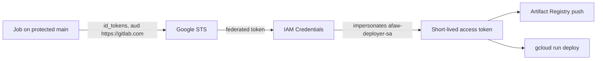

# Google Cloud setup

How AFAW Hands-off reaches Google Cloud: what is created, who may do what, how GitLab CI
authenticates without a key, and the exact steps a human runs once. The decision behind it is
[ADR 0008](adr/0008-deploy-to-cloud-run-with-workload-identity-federation.md). No project ID,
project number, billing account or bucket name is written in this repository: they are
Terraform variables, git-ignored files and protected CI/CD variables.

## What gets deployed

A read-only web service (`src/afaw_web`) on Cloud Run. It serves files baked into its image, so a
request never reaches a database, a secret or a paid model.

| Endpoint | Answers with |
|---|---|
| `/` | The demo dashboard, built from invented mock data |
| `/live/` | This repository's own dashboard, built from `main` |
| `/health` | `200 {"status":"ok"}` only when every baked-in view is present, otherwise `503` and the names of what is missing |
| `/api/state` | The derived metrics, pending tasks and history, exactly as the engine wrote them |
| `/api/ask?q=` | A deterministic keyword search over the ADRs, gotchas and `LASTCONTEXT.md`. It cites the file path and copies lines verbatim; no language model is called |

Every other method (`POST`, `PUT`, `PATCH`, `DELETE`) answers `405`.

## What Terraform creates

`deploy/terraform` creates new resources only. A plan against an empty prefix must show only
additions (11 to add, 0 to change, 0 to destroy); if it shows a change or a destroy of anything
that already exists, stop.

| Resource | Purpose |
|---|---|
| Workload Identity pool `afaw-gitlab` and provider `gitlab` | Lets GitLab CI exchange a job token for a short-lived Google credential. Not shared with any other pool |
| Service account `afaw-deployer-sa` | What CI impersonates to deploy. No key exists |
| Service account `afaw-runtime-sa` | What the service runs as. It has no roles at all |
| Artifact Registry repository `afaw-images` | Where CI pushes the image Cloud Run pulls |
| Cloud Run service `afaw-handsoff` | The public read-only service |

### Cost and scale settings

These are the sustainability data-capture settings; they live in `deploy/terraform/cloud_run.tf`.

| Setting | Value | Why |
|---|---|---|
| Minimum instances | 0 | Scales to zero when idle: no idle compute |
| Maximum instances | 2 | A hard cap on what a traffic burst can cost |
| CPU / memory | 1 / 512Mi | Enough for a service that reads small files |
| Request timeout | 30 s | A stuck request cannot run for long |
| Paid calls per request | none | `/api/ask` is a file search, not a model call |

The budget alert is created by the human in the Google Cloud console. The billing account is not
referenced anywhere in this repository.

## Who may do what

| Identity | Role | On what |
|---|---|---|
| GitLab CI (federated) | `roles/iam.workloadIdentityUser` | The deployer service account only, and only for tokens of this project's protected default branch |
| `afaw-deployer-sa` | `roles/run.developer` | The one Cloud Run service |
| `afaw-deployer-sa` | `roles/artifactregistry.writer` | The one repository |
| `afaw-deployer-sa` | `roles/iam.serviceAccountUser` | `afaw-runtime-sa` only |
| Everyone (`allUsers`) | `roles/run.invoker` | The one Cloud Run service. The service is public by design |

There are no project-wide roles, no `admin`, `owner` or `editor` roles, and no service-account
keys. `tests/tooling/test_terraform_guardrails.py` fails the build if any of that changes.

## How GitLab CI authenticates



`deploy/gcp_access_token.sh` performs the two exchanges with `curl` and prints only the final
access token. The provider rejects a token unless **all** of these hold, so a branch pipeline or a
merge request pipeline cannot obtain credentials:

| Claim | Must equal |
|---|---|
| `project_id` | the numeric id of this GitLab project |
| `namespace_id` | the numeric id of this GitLab namespace |
| `ref_type` | `branch` |
| `ref` | the default branch (`main`) |
| `ref_protected` | `true` |

The issuer is `https://gitlab.com` and the allowed audience is `https://gitlab.com`, which equals
the `aud` of the `id_tokens` in `.gitlab-ci.yml`.

## Terraform state

The state is in an existing Google Cloud Storage bucket under a **new prefix** (`afaw-handsoff`),
so it cannot collide with another stack. The backend is a partial configuration: the bucket is
passed with `-backend-config=backend.hcl`, a git-ignored file, so no bucket name is committed.
`deploy/terraform/backend.hcl.example` shows the shape.

GitLab-managed state was the other option. It needs no bucket and authenticates with the job
token, but writing it requires the Maintainer role and the state would live outside the Google
Cloud project that owns the resources. The bucket keeps both under one owner.

## One-time steps for the human

No API needs enabling: `run`, `artifactregistry`, `iam`, `iamcredentials` and `sts` were already
enabled in the project. If `terraform apply` complains about `cloudresourcemanager.googleapis.com`,
enable it with `gcloud services enable cloudresourcemanager.googleapis.com --project=<project id>`.

1. Fill the values (nothing here is committed):

   ```bash
   cd deploy/terraform
   cp backend.hcl.example backend.hcl        # set bucket; keep prefix = "afaw-handsoff"
   export TF_VAR_gcp_project_id="<project id>"
   export TF_VAR_region="<region>"
   export TF_VAR_gitlab_project_id="<CI_PROJECT_ID>"
   export TF_VAR_gitlab_namespace_id="<CI_PROJECT_NAMESPACE_ID>"
   ```

2. Plan and read it. It must say `11 to add, 0 to change, 0 to destroy`:

   ```bash
   terraform init -backend-config=backend.hcl
   terraform plan -out tfplan
   ```

3. Apply it yourself, then read the outputs:

   ```bash
   terraform apply tfplan
   terraform output
   ```

4. In GitLab, **Settings > CI/CD > Variables**, add these as **protected** (and masked where
   GitLab accepts the value). Only the names appear in this repository.

   | Variable | Value |
   |---|---|
   | `GCP_PROJECT_ID` | the project id |
   | `GCP_REGION` | the region |
   | `GCP_WORKLOAD_IDENTITY_PROVIDER` | output `workload_identity_provider` |
   | `GCP_DEPLOYER_SERVICE_ACCOUNT` | output `deployer_service_account` |
   | `GCP_ARTIFACT_REPOSITORY` | output `artifact_repository` |
   | `GCP_SERVICE_NAME` | `afaw-handsoff` |
   | `GCP_SERVICE_URL` | output `service_url` |

5. Merge to `main`. The `check_configuration` job fails loudly if a variable is missing; the
   `publish_image`, `deploy_cloud_run` and `monitor_live` jobs run only there.

## What was verified, and what was not

Verified in the documentation on 2026-10-24: GitLab `id_tokens` and the claim names; the
Google Workload Identity Federation provider fields, attribute conditions, member formats and
impersonation; GitLab-managed Terraform state; the Cloud Run and workload-identity-provider
Terraform arguments. `terraform fmt`, `validate` and a `plan` against the real backend were run
locally.

Not verified until the first run on `main` (nothing here is claimed to work before then):

| Open point | Why it is open |
|---|---|
| Issuer string | GitLab's discovery document says `https://gitlab.com`; GitLab's Google page mentions a trailing slash. The provider uses the discovery value, which is what the token's `iss` claim carries. A real token confirms it |
| Type of `ref_protected` | The GitLab example shows a string, the description reads like a boolean. The condition uses `string(...)` so it holds for both, and fails closed otherwise |
| The deploy jobs | They cannot run before the human applies Terraform and sets the variables |

Known gap, accepted: a public endpoint with no rate limiting. The cost is bounded by the maximum
of two instances and by the fact that no request makes a paid call.
