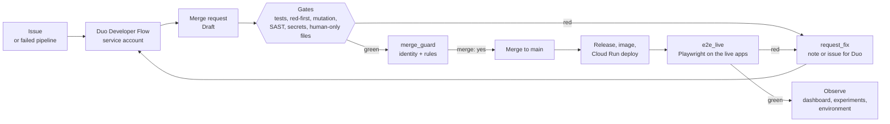
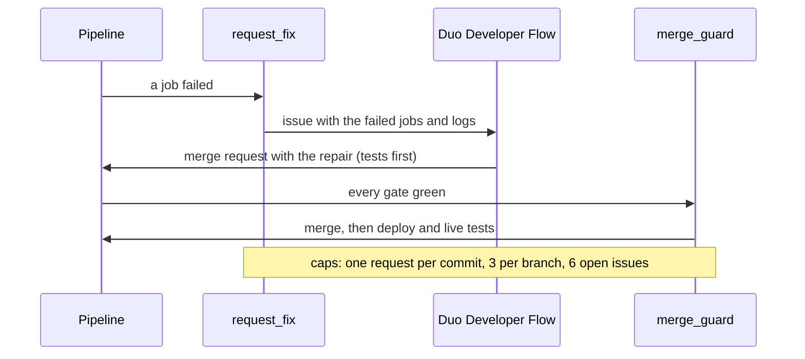
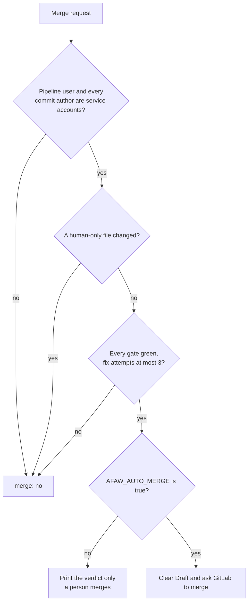

# The AFAW Engine method: hands-off from issue to production

AFAW upstream (the original method, [`afaw.pdf`](paper/afaw.pdf)) has agents in isolated terminals
and a human who approves every pull request. AFAW Engine keeps its core (the AI decides, the engine
measures; one task, one branch, one record; the red step checked by a tool) and replaces the human
approval of each merge with deterministic gates and a merge decision made by code. The human
approves the policy once ([ADR 0007](adr/0007-engine-approves-each-merge-human-approves-the-policy.md)).

The diagrams below are Mermaid, so GitLab renders them. Each arrow is a link of
[`evidence.md`](submission/evidence.md); a link that has not run is marked in the README table.

## 1. The loop

## 2. Self-repair

A failure is an input, not a stop. `request_fix` turns the failed jobs and the end of their logs into
a note on the merge request or an issue on `main`, labelled `afaw-autoheal` and assigned to the
Developer Flow account.

## 3. Who may merge

## 4. Control layers

| Layer | What it does | Strength |
|---|---|---|
| Rules (`AGENTS.md`) | Tell every agent how to work | Advice |
| Red-first and mutation gates | A new test must fail on the old code; changed files are mutated | Deterministic, in CI |
| Security gate | SAST and secret detection become a blocking decision | Deterministic, in CI |
| Identity | Pipeline user and commit authors must be service accounts | Deterministic, from the API |
| Human-only files | `.gitlab-ci.yml`, `deploy/`, `AGENTS.md`, `state/config.json` | Weak today (a CI job); a strong control is planned |
| Merge decision | `merge_guard` | Deterministic; on only when a person sets `AFAW_AUTO_MERGE=true` |
| Live verification | The pipeline proves the commit that runs, then Playwright uses the apps | Deterministic |

## 5. Observability

| What | Where |
|---|---|
| Project state, in the browser, every 30 seconds | Live panel of the dashboard (`/`) |
| Measured experiments with their sources | `/experiments/` |
| Carbon estimate with its assumptions | `/environment/` |
| The commit and release that run | `/api/version` of both services |
| Browser tests on the live apps | `e2e_live`, screenshots as artifacts |
| Per-event audit trail of self-repair | Planned: [`plan-telemetry-and-budget.md`](plan-telemetry-and-budget.md) |

## Why this is cheaper than reading the code

An agent starts from one generated index (`LASTCONTEXT.md`) and the derived views instead of
searching the code; the gates run in CI once instead of in every session. This is expected, not
measured: the comparison is planned in [`experiments.md`](experiments.md).
