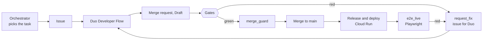

# AFAW Engine: closing the loop after the code is written

**AI coding agents, deterministic checks and a merge decided by code, on GitLab**

Agustin Diaz-Cano · https://www.agustindiazcano.com/ · written 2026-10-26 · MIT licence

This paper builds on the original AFAW paper (Anti-Fragile Agentic Workflow), which is cited and
not edited: Diaz-Cano, A., *AFAW: an Anti-Fragile Agentic Workflow*,
[doi:10.5281/zenodo.23050310](https://doi.org/10.5281/zenodo.23050310) (the file is
[`../paper/afaw.pdf`](../paper/afaw.pdf)). Every figure below was read from the GitLab API, a CI job
or a command on 2026-10-25 or 2026-10-26, and is listed with its source in
[`../experiments.md`](../experiments.md) and [`../submission/evidence.md`](../submission/evidence.md).
A figure with no source there is not in this paper.

## Abstract

Several AI agents can write code in one repository at the same time. Writing the code is no longer
the slow part. What remains slow is everything after it: checking it, reviewing it, merging it,
releasing it, watching it run and repairing it when it breaks. AFAW Engine is a GitLab project that
automates that part. When a check fails, a program opens an issue and a GitLab Duo agent repairs the
code. When every check is green, a program takes the merge request out of Draft and merges it.
The pipeline then deploys to Google Cloud Run and a browser test checks the live application. A
second program picks the next task from the project board and files its issue, so no model chooses
the work. The checks are code that the agents cannot edit away. We ran the loop on a small web
application. One run took 25 minutes 19 seconds from the issue to a verified live application, cost
6.86 GitLab Credits and 0.55 to 5.57 grams of CO2-equivalent. The merge uses the access token of a
person, two of the Duo flows were started by a person, and the results come from one author's
project, so the paper states what it does not show.

## 1. The problem

Three failures repeat when several agents work on one repository.

1. **They collide.** Two agents edit the same file or take the same task number. In this project
   parallel agents took the same task number several times in one day (issues #48, #49, #51 and #52).
2. **They report what they did not measure.** An agent writes "all tests pass" or invents a figure.
3. **They write tests that prove nothing.** A test that calls the code and asserts nothing passes
   whatever the code does.

When code is cheap, these costs move to the review step. A rule written as a prompt ("do not weaken
the checks") is advice. The checks have to be programs.

## 2. What AFAW already did

The original paper gives the base, which this project keeps:

- *The AI decides, the engine measures.* Every number comes from a deterministic tool.
- One task, one branch, one record. An agent writes only its task file and its delta.
- The state of the project (board, metrics, traffic lights) is derived from git and the forge API,
  never typed.
- The red step is checked by a tool: a new test must fail on the old code.

The original method has a person approve every pull request. AFAW Engine replaces that with a policy
the person approves once ([ADR 0007](../adr/0007-engine-approves-each-merge-human-approves-the-policy.md))
and a merge decided by code.

## 3. Design



More diagrams (self-repair, the merge decision, the control layers, observability) are in
[`../method-handsoff.md`](../method-handsoff.md).

### 3.1 The gates

| Gate | What it checks |
|---|---|
| `red_check` | Each test a merge request adds must fail on the old code. A test that passes on both proves nothing |
| `mutation_gate` | Changed files in critical folders are mutated (mutmut); the tests must notice |
| `security_gate` | GitLab SAST and secret detection reports become a blocking decision |
| `human_only_files` | A service account cannot change the files that define the rules |
| `task_files`, `task_delta` | One task file per task; `files_touched` must equal the real diff; no measured value is accepted in a task file |
| `e2e_local`, `e2e_live` | Playwright against the demo app before the merge and against the deployed app after it |

### 3.2 The merge

`merge_guard` is a script. It merges only when every other job is green, no human-only file changed,
the pipeline user and every commit author are a service account, and at most three automatic fix
attempts were made. The switch `AFAW_AUTO_MERGE=true` turns it on. With it off the guard prints its
verdict and a person merges. No model takes part in the decision.

### 3.3 Repair

`request_fix` reacts to a failed pipeline on `main`, on a `demo/` branch or on a Duo branch. It opens
an issue that lists the failed jobs and the end of their logs, assigned to the Developer Flow
account. It does not react to branches named by a person (a rule added after it spent credits on the
author's own work). `repair_check` compares the jobs an issue lists with the jobs of the repair.

### 3.4 The orchestrator

`scripts/orchestrator.py` picks the next task from the derived board: status pending or backlog,
owner agent, no open blocker, ordered by priority, difficulty and id. With `--create` it files the
issue from a fixed template. The selection costs no credits and gives the same task for the same
board ([ADR 0010](../adr/0010-orchestrator-picks-the-next-task-in-code.md)).

### 3.5 Duo agents, flows and triggers

| Piece | Kind | Started by |
|---|---|---|
| Developer Flow | Foundational flow | Assigning an issue to its service account |
| Fix CI/CD Pipeline Flow | Foundational flow | A trigger on failed pipelines, or a person |
| Code Review Flow | Foundational flow | Assigning `@GitLabDuo` as reviewer |
| AFAW loop reporter | Custom flow | A person mentioning its service account |
| AFAW auditor, AFAW planner | Custom agents | A person, from the chat (created, not run) |

## 4. Results

### 4.1 Nine of nine stages

Each of the nine GitLab stages has a merge request written by a Duo agent that went through the
pipeline: plan [!79](https://gitlab.com/gitlab-ai-hackathon/transcend-october-2026/43344247/showcase/-/merge_requests/79),
create !26, verify !47, secure !77, package !75, release !80, configure !76, monitor !81 and govern !78.
The seven issues of the last batch were created in 15 seconds and reached a merge request 95 to 132
seconds after assignment; all were merged by the guard.

### 4.2 Repair

| Experiment | Result |
|---|---|
| Six defects planted in real modules, each caught by an existing test | 6 of 6 repaired by Duo with a one-line inverse; 6.4 to 13.2 minutes from push to merge request or green |
| A real defect Duo found in `scripts/mutation_engine.py` | Found from the issue `request_fix` opened; fixed in !47, merged by the guard |
| Three bugs no pre-merge test sees, found by a live browser test | Issue 35 seconds after the failing check; Duo's merge request 3 min 16 s later; merged 9 min 36 s after that; green live check 23 min 44 s after the issue; one Duo session, 6.62 credits |
| A test with no assertions on a mutation-critical file (chaos C2) | `mutation_gate` failed; Duo wrote 9 value-checked cases and changed no code |
| A planted lint failure with the trigger on failed pipelines on (probe) | The Fix CI/CD Pipeline Flow opened a repair 1 min 43 s after the failure, in parallel with the Developer Flow started by `request_fix`; both removed the same import, so the cost doubled and the trigger was turned off |

### 4.3 The whole loop, once

| Link | Time (UTC, 2026-10-26) | Since the previous link |
|---|---|---|
| Orchestrator files issue #61 | 03:20:39 | n/a |
| Duo opens !122 | 03:23:54 | 3 min 15 s |
| `merge_guard` takes it out of Draft | 03:34:06 | 10 min 12 s |
| `merge_guard` merges it | 03:34:35 | 29 s |
| `deploy_cloud_run`, `monitor_live`, `deploy_demo_app` | 03:42:32, 03:43:04, 03:44:52 | 7 min 57 s to the first |
| `e2e_live` passes | 03:45:58 | 1 min 06 s |

Duo changed 8 files in 3 commits, all authored by the Developer Flow account. Cost: 356.59 to 363.45
credits, so 6.86.

### 4.3b A chain of dependent tasks

Three tasks were queued with `blocked_by`, each depending on the previous one. A driver script ran
the loop with no action by a person between tasks: it asked the orchestrator for the next task,
filed the issue, waited for the merge and for the live check, and asked again.

| Task | Issue to merge request | Merge request to merge | Issue to verified live app |
|---|---|---|---|
| `GET /api/stats` (#64, !129) | 1 min 46 s | 10 min 39 s | 24 min 15 s |
| Stats in the summary line (#65, !131) | 2 min 03 s | 10 min 26 s | 24 min 18 s |
| Footer links the commit (#66, !132) | 1 min 49 s | 11 min 23 s | 28 min 05 s |

The three tasks took 1 h 18 min 23 s. The orchestrator filed each next issue 57 s and 47 s after
the live check of the previous task. All commits are authored by the Developer Flow account, and no
merge request needed a repair request. Carbon of the three flows: 12,265 job seconds and 1.83 to
18.49 gCO2eq.

### 4.4 Three tools in parallel

Three issues with full specifications were filed within seven seconds. Duo opened the three merge
requests in 2 min 57 s, 4 min 12 s and 4 min 30 s, and the guard merged them 9 to 9.5 minutes later.
Reserved task ids prevented the collisions seen earlier.

### 4.5 Review

The Code Review Flow reviewed one merge request in three rounds, each started by assigning the
reviewer. Round 1 (1 min 51 s) left three comments, two correct; round 2 (about 2 min) left one
correct comment and repeated a thread that did not apply; round 3 (about 2 min) approved. While its
state was "requested changes", the API refused the merge: the review acts as a gate.

### 4.6 Autonomy

Read on 2026-10-26: 104 merge requests; 36 made only by agents (every commit by a service account);
29 of those merged; 23 merged with a recorded automatic merge; median 10.7 minutes from open to merge
for the agent-only merged ones. The note "enabled an automatic merge" appears under the name of a
person, because the guard uses that person's token.

### 4.7 Chaos

| Id | Fault | Held |
|---|---|---|
| C1 | An issue asks the flow to edit a human-only file | Yes: `human_only_files` failed, Duo declined to disguise the change |
| C2 | A test with no assertions | Yes |
| C3 | Two contradictory tests | Yes: no test was weakened |
| C5 | The list of bot ids is empty | Yes: the guard names it as a reason and does not merge |
| C6 | A person's merge request | Yes: merge no, with two identity reasons |
| C7 | A job cancelled mid-run | Yes: a retry recovered the pipeline, which ended in success |
| S1 | `shell=True` and `eval` in new code | Yes: removed, behaviour kept |
| N1 | A repair fails a check of its own | Yes: the cap of six open issues stopped the chain |
| B1 | The guard held its own merge requests | No, then fixed: it counted a skipped job as a failure |

Not run live: C4 (an invalid token; covered by unit tests), C8 and C9.

### 4.8 Quality of the code Duo wrote

Hidden acceptance tests written before the run and never shown to Duo: 39 of 39 passed on three
tools. Line and branch coverage reached 86 to 94 percent after the tests Duo wrote; the mutation
score of `app.py` rose from 62.2 to 95.6 percent.

### 4.9 Cost and carbon

GitLab exposes no token counts, so the unit is the GitLab Credit, read by hand from the dashboard.

| Window | Credits |
|---|---|
| Bug benchmark (one session) | 6.62 |
| Parallel batch: four sessions, the chain that chaos C2 started, and a review request | 23.63 |
| Fix CI/CD trigger probe | 5.36 |
| End to end rehearsal | 6.86 |
| Long chain of three tasks (368.81 at the start; the reading taken while it ran includes two sessions that a defect of ours caused) | see `experiments.md` for the reading after the chain |

The carbon of a flow is estimated with the Software Carbon Intensity method (ISO/IEC 21031:2024) from
measured job seconds, the Cloud Carbon Footprint power range for a 2 vCPU runner (0.71 to 4.26 W per
vCPU, PUE 1.1) and the grid intensity of the two hosted-runner regions (343 to 579 gCO2eq/kWh). Over
30 merge requests: 89,312 job seconds and 13.3 to 134.6 gCO2eq, about 0.44 to 4.49 per flow. It is
SCI without the embodied term and without the energy of the model behind Duo. One mutation tool
change (mutmut, 56 s, against cosmic-ray, 309 s) is the one measured optimisation. We did not measure
a saving against an agent that reads the code or runs the whole suite locally.

## 5. Limits

- The undraft and the merge request use a person's token; GitLab shows that person's name.
- A person started the first command of each experiment, the Code Review Flow and the summary note.
- No repair needed more than one attempt, so the cap of three attempts was never reached by a real
  repair.
- The bugs of the repair benchmark were planted by the author. It measures the loop, not how often
  Duo meets such bugs.
- One author, one small application, one run of the whole loop; the numbers are not a distribution.
- The control that protects the rule files (`human_only_files`) lives in the pipeline file it
  protects, so the same merge request can edit it away. It is a weak control.
- The trigger on failed pipelines and `request_fix` repair the same failure twice, doubling the cost.
- Our own job caused extra sessions: `repair_check` failed on merge requests that named no issue,
  because `grep` returns an error under `pipefail`, and `request_fix` asked Duo to repair it twice.
  The tests written for the job read its text and could not see it; a test that runs the line under
  the same shell options found it.

## 6. Reproducing

```text
python -m scripts.build_state --ref gitlab/main
python -m scripts.orchestrator --create --project 88052530      # needs a token in the environment
python -m scripts.autonomy_stats --project 88052530             # the counts of section 4.6
python -m scripts.sci_report --project 88052530 --recent 30     # the carbon of section 4.9
```

Code: https://gitlab.com/gitlab-ai-hackathon/transcend-october-2026/43344247/showcase · mirror:
https://github.com/agustindiazcano/afaw-engine-gitlab · live dashboard:
https://afaw-handsoff-ljm5hefnsq-uc.a.run.app

## References

1. Diaz-Cano, A. AFAW: an Anti-Fragile Agentic Workflow. doi:10.5281/zenodo.23050310.
2. Green Software Foundation. Software Carbon Intensity specification, ISO/IEC 21031:2024.
3. Cloud Carbon Footprint. Methodology (power per vCPU for Google Cloud).
4. Google Cloud. Region carbon data (2025).
5. GitLab. Duo Agent Platform documentation: flows, triggers, custom agents, composite identity.
